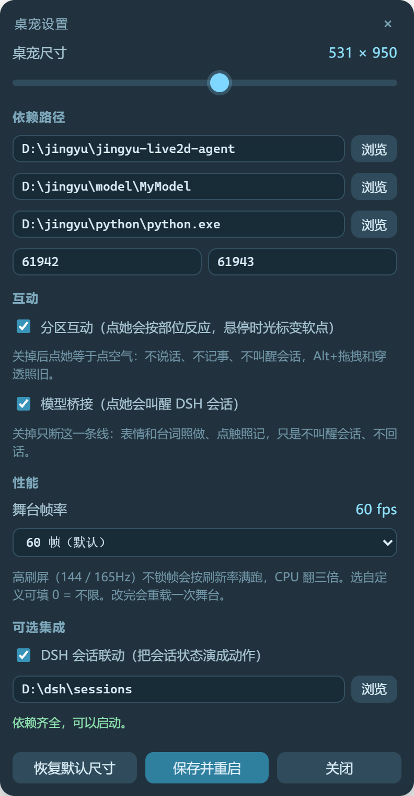

# whale-pet-shell

把 **鲸语（Jingyu Live2D Agent）** 的 `?stage=1` 舞台变成 Windows 桌面上的透明桌宠外壳。

壳子本身只做「窗口 + 交互 + 玩法」，不做渲染、不带模型：模型、鲸语、Live2D Cubism Core 全部由使用者自备。

```
鲸语舞台（本机 HTTP）  ←  壳子（Electron 透明窗口 / 托盘 / 面板 / 玩法层）
      ↑ 动作执行                    ↓ 情绪、气泡、指针、尺寸
   /api/execute              127.0.0.1:61943
```

## 预览

设置面板（托盘 → 设置…，或 `node cli/pet.mjs panel`）。第一次运行时如果依赖没配好，外壳会直接把这个面板弹出来。



> 截图里只有外壳自己的界面。角色和模型不在本仓库内，也不提供。

## 它提供什么

- **透明无边框窗口**：置顶、点透明处穿透到下层窗口、点角色身上可交互，按住 `Alt + 左键` 拖动
- **像素级智能穿透**：只认角色像素，靠 `preserveDrawingBuffer` + 命中框实现（需要补丁，见下）
- **托盘菜单**：显示/隐藏、置顶、穿透、近景/全身、尺寸、气泡位置、开机自启、设置
- **尺寸面板**：滑杆实时预览，比例锁定；也可 `Ctrl + 滚轮` 在角色身上调
- **帧率可调**：设置面板「性能」里 30 / 60 / 90 / 自定义（0 = 不限）。高刷屏不锁帧会按刷新率满跑，实测 CPU 差三倍
- **指针追踪**：全局鼠标位置持续喂给模型（着头/上身/前探/侧移），窗口穿透或指针在窗口外也有效
- **绕圈生气**：围着她的头部转满一圈 → 眩晕 → 嫌弃 → 黑脸 + 手放胸前，进冷却
- **分区互动**：点是哪就反应哪（头发 / 脑袋 / 脖子 / 胸口 / 腰 / 裙摆 / 腿 / 脚），分区只带情绪、台词一律是语气词（呃…／呜…／嘿嘿…／呀…）；同一处连点三下会翻脸
- **点触事件反推**：每次点击都落盘 `data/touch.jsonl`，并可选 POST 给外部桥（`bridgeUrl`），用来唤醒别的进程
- **情绪端口**：`POST 127.0.0.1:61943/mood {"emotion":"shy","intensity":0.8}`，12 种情绪映射成鲸语 plan
- **气泡**：`POST /say {"text":"…"}` 出对话气泡，可选接自己的 TTS
- **阶段气泡**：`POST /tick {"text":"看 main.js","ms":3000}` 从上半身肩线冒出小气泡，边飘边淡，单颗 2~4 秒、最多同时 5 颗（联动用它说「在想 / 跑命令 / 看文件」，面板里能关）
- **气泡回复**：她说完话，气泡角上挂一个小蓝钮；鼠标靠近气泡就先不淡，点开就能在桌宠窗口里直接打字，回车把这句话投给桌宠专用会话（要先填 `bridgeUrl`），她的回话再以气泡回流
- **CLI**：`cli/pet.mjs` 把上面这些都包成命令行

可选集成（默认关闭）：DSH 会话联动 `integ/dsh-watch.mjs`，把会话状态（读文件/写文件/跑命令/子代理/卡住/报错）演成**表情 + 肩上的阶段气泡**，不再推她的头。

## 前置条件（不提供，需自行获取）

| 依赖 | 说明 |
|---|---|
| **鲸语 Jingyu Live2D Agent** | 舞台和动作编译器。本外壳适配 `1.4.0-beta.2`，需要 `web/app.mjs`、`web/engine.mjs` |
| **Live2D 模型** | 你自己的 `.model3.json` + moc3 + 贴图 + 物理。**本仓库不含任何模型** |
| **Live2D Cubism Core** | 从官方 SDK 获取 `live2dcubismcore.min.js`，按 Live2D 许可放进鲸语的 `web/vendor/`。**本仓库不含** |
| **Node.js ≥ 20** | 跑 Electron 外壳和 CLI |
| **Python 3.10+** | 鲸语自己的依赖，按鲸语 README 装 |

## 安装

```powershell
git clone <this-repo> whale-pet-shell
cd whale-pet-shell
npm install                      # 装 Electron（约 250MB）

# 给鲸语打舞台补丁（仓库外的那份鲸语）
node patch/apply-jingyu.mjs --repo "D:/path/to/jingyu-live2d-agent"
node patch/apply-jingyu.mjs --repo "D:/path/to/jingyu-live2d-agent" --check
```

补丁只做五处最小插入，幂等、自动备份 `.whale-pet-bak`，可 `--revert` 还原：

1. `app.mjs`：`?stage=1` 舞台模式判定
2. `app.mjs`：`preserveDrawingBuffer`（像素级穿透要读 canvas alpha）
3. `app.mjs`：锁帧（默认 60fps，`?fps=0` 不限）—— 高刷屏不锁帧会跟着 144/165Hz 满跑，白烧 CPU
4. `app.mjs`：暴露 `window.__stageEngine / __stageModel`、订阅壳子送来的指针、定时写 `#scene[data-hit]` 命中框
5. `engine.mjs`：新增 `pointer` 驱动阶段（优先级 15），把指针映射到 `AngleX/AngleY/AngleZ/LeanInput/PositionX`

> 找不到锚点会直接报错、不写入。鲸语改版后锚点可能变，那时按报错手改，或对照本仓库 `patch/apply-jingyu.mjs` 里的插入内容。

## 配置

双击 `start-pet.cmd`（或 `npm start`）。**配置文件不完整时只弹设置面板**，填完保存会自动重启：

| 字段 | 含义 |
|---|---|
| `jingyuRepo` | 鲸语仓库目录（含 `server.py`） |
| `modelDir` | 模型目录（含 `*.model3.json`）；留空默认取 `<jingyuRepo>/model/DeepSeek` |
| `pythonPath` | Python 解释器；留空用 PATH 里的 `python` |
| `stagePort` / `moodPort` | 鲸语端口（默认 61942）/ 本外壳控制端口（默认 61943） |
| `dshWatch` + `dshSessionsDir` | 可选：DSH 会话联动 |
| `moodJson` | 可选：外部心情文件（有就同步情绪） |
| `voicePrepare` + `voiceWavDir` | 可选：外部 TTS 桥脚本与音频目录 |
| `voiceKeepAlive` | 每 15 分钟打一次声（默认开）：顺手把 TTS 服务热着，最近没人理她就真说一句短招呼 |
| `bridgeUrl` | 可选：点触事件 POST 到哪里（反向桥，例如 `http://127.0.0.1:61944/event`） |
| `stageFps` | 舞台帧率上限，默认 60（`0` = 不限）。高刷屏不锁帧会按显示器刷新率满跑，CPU 翻三倍 |
| `dock` | 启动时贴到哪：`none`（默认，记住上次位置）/ `left` / `right` |
| `dockTitle` | 要贴的那个窗口，填它标题里的一段（比如浏览器标签页标题里的项目名）；**留空 = 不贴**，默认就是空 |
| `dockGap` | 和目标窗口之间留多少像素，默认 8 |

配置存在 `data/config.json`，日志在 `data/pet.log`。

### 语音：仓库里一个音频文件都没有

台词**只有文字**，声音全靠使用者自己的 TTS（`voicePrepare` 接一个把文本合成 wav 的脚本，`voiceWavDir` 是它输出的目录）。本仓库不附带、也不上传任何语音成品：合成出来的 wav、预合成缓存 `data/voice-cache.json`、以及任何克隆音色的样本都不在版本库里，`data/` 与 `*.wav / *.mp3 / audio/` 都在 `.gitignore` 里。

想让她出声就自己准备音色——用你自己的 TTS 或自己克隆的声音，别把成品公开发布。

**TTS 完全可选**：不填 `voicePrepare` / `voiceWavDir` 就是个哑巴桌宠——气泡、口型、点触、回复钮全都照常，只是不出声。`/say {voice:true}` 会直接当普通气泡处理并回 `{ok:true, queued:false, noTts:true}`，不会排三个点、也不会报错；预合成、保活、音量菜单这些跟声音有关的东西一律自动跳过。

**TTS 保活**（`voiceKeepAlive`，默认开）：本地 TTS 服务空闲久了第一句要 20~27 秒合成，中间气泡只能停在三个点。所以每 15 分钟打一次声——最近 15 分钟有人在动，就安静地合成一句随即扔掉的短句把服务热着（不出声、不进缓存、产物删掉）；真闲下来了才说一句短招呼（气泡 / 口型 / 声音同帧），两声招呼之间至少隔 45 分钟，只在 8~24 点之间开这个口。启动 90 秒后也会先热一次，省得开工第一句干等。手动触发：`POST :61943/keepalive {"mode":"greet"|"ping"}`。

## 控制接口（61943）

```
GET  /status                    情绪列表、音量、最近一次说话
POST /mood    {emotion, intensity}
POST /say     {text, emotion?, gesture?, voice?, early?}
POST /dock    {mode: "left"|"right"|"none", title?}   贴到窗口旁边（默认按标题找 DSH）
POST /size    {width, height}
POST /fit     {fit: "portrait"|"full"}
POST /cursor  {on?, spin?, reset?}
GET  /cursor                    窗口位置、鼠标、调戏区、绕圈阶段
GET  /bubble  POST /bubble      气泡文本与位置
POST /tick    {text, ms?}       阶段气泡（小、贴肩、2~4 秒消失）   GET /tick 看当前那条
POST /reply   {text} | {open}   在主人在桌宠里打的那句话投给桌宠专用会话；{open:true/false} 开关输入卡（调试用）
GET  /reply                     回复钮状态：开着没、输入卡开着没、当前文字
POST /sway    {on, phys, tilt, period}   GET /sway
POST /touch   {zone, nx?, ny?}   模拟一次点触（zone: hair/head/neck/chest/waist/skirt/leg/foot/body）
GET  /touches?limit=20           最近的点触记录
GET  /fps  POST /fps {fps}       舞台帧率上限（0 = 不限），改完自动重载舞台
```

情绪：`happy shy excited thinking sleepy proud sad annoyed surprised greeting playful neutral`

## CLI

```powershell
node cli/pet.mjs state
node cli/pet.mjs say "主人回来啦" --emotion happy
node cli/pet.mjs reply "在吗，我看到气泡了"   # 替主人回她一句（走桌宠专用会话）
node cli/pet.mjs expr 脸红 --and look=down
node cli/pet.mjs gesture hand_on_chest
node cli/pet.mjs sway --phys 0.2 --tilt 0.6 --period 4.0
node cli/pet.mjs touch head
node cli/pet.mjs touches 20
node cli/pet.mjs fps 30            # 舞台帧率上限（0 = 不限）
```

端口会读 `data/config.json`，也可用 `WHALE_PET_STAGE_PORT` / `WHALE_PET_MOOD_PORT` 覆盖。

## 可选：DSH 会话联动

`integ/dsh-watch.mjs` 读 DSH 会话事件流，把「读文件 / 写文件 / 跑命令 / 网页 / 子代理 / 卡住 / 报错 / 答完」演出来。默认关闭，在设置面板勾上并填会话目录即可。

分工是：**表情走舞台**（`/api/execute`，只发 `expression`，不动头不动身体），**过程提示走气泡**（`POST /tick`，从肩线往上飘，单颗 2~4 秒、最多同时 5 颗，面板里能关）。气泡文案是随机说法池，同一个状态换着说：让我想想 / emmm... / 让我看看 main.js / 跑一下 node --check / 查查 xxx / 啧，翻车。两条线互不干扰——身体留给指针追踪、待机摇摆和说话手势。

## 可选：反向桥（把她变成输入设备）

她不只是被指挥，也可以反过来叫醒别的进程。填了 `bridgeUrl` 之后，每一次点触都会 POST 到那个地址：

```json
{"ts":"2026-11-01T07:15:04.608Z","seq":4,"zone":"head","nx":0.501,"ny":0.2}
```

这条线可以单独关掉：`config.bridge`（托盘「互动 ▸ 模型桥接」/ 设置面板「互动」里的第二个勾选框 / `node cli/pet.mjs bridge off` / `POST :61943/bridge {"on":false}`）。关掉后表情、台词、`touch.jsonl` 全都照旧，只是不再叫醒会话——适合想自己逗她玩、又不想每摸一下都烧一次模型的时候。它和 `interactive` 是两层开关：`interactive` 关了是连本地反应都没有。

同一份数据也会追加进 `data/touch.jsonl`（超过 256KB 自动轮转成 `touch.jsonl.1`），随时可以 `GET /touches` 或 `node cli/pet.mjs touches` 回看主人都点了哪儿。

DSH 这边的接法是 `bridge/dsh-pet-bridge/` 这个插件：收到事件后按 `sessionController.resolveAgent → agent.followup → sessions.flush` 投一条 user 消息，于是「摸头」真的会触发一次模型调用。它带同部位 2.5 秒合并、每分钟 8 条上限，避免连点刷屏。

**默认投专用会话，不碰主会话**（`mode: pet`）：第一次点触时它会 `sessionController.create()` 建一个固定会话（自动改名「桌宠互动」，用 `agentPreset` 指定的预设，默认 `bigfish-pet` —— 只有人设、没有工具，免得桌宠那股劲儿跟你写代码那股劲儿混在一起），之后所有点触都投那儿。这样正在写代码的主会话不会被「主人刚刚碰了你的胸口」插进等候区。会话 id 落在 `$DSH_HOME/pet-bridge.json`，重启沿用；`POST :61944/reset-pet-session` 换一个干净的；把 `mode` 改成 `main` 就退回旧行为（投最近活跃会话）。预设名没在这个进程里注册时，`/health` 的 `petPreset` 会和 `petPresetWanted` 对不上，日志里也会留一行警告。

**回复回流成气泡**（`echoToPet`，默认开）：那个会话里我一旦说话，桥就等到这一轮结束，把最后一段文本洗掉 markdown / 贴纸 / 代码块、截到 `echoMaxChars`，再 `POST` 回 `:61943/say`——于是桌面真的会出现气泡 + 口型，而不是只躺在聊天窗口里。一轮多条只出最后一条；被打断的残句不播。

**语音**（`echoVoice`，默认关）：打开后只念 `echoVoiceMaxChars`（默认 40）以内的短回复。合成期间气泡停在三个点，合成好之后正文、口型、声音同帧一起出；`early: true` 只让表情和手势提前摆好，正文不会提前漏。改配置要重启 DSH。

**顺带控制表情和手势**：投给桌宠会话的消息后面会附一句口径（一句、**5~20 字**、越短越好、别排版），并允许模型在最前面写 `[emotion:shy]` / `[gesture:hand_on_chest]`，桥把这俩摘出来交给 `/say`，标记不进气泡；认不出的名字直接忽略、正文照留。

**反过来，在桌宠里回她一句**（`config.replyBtn`，默认开）：她说完话，气泡右上角挂一个小蓝钮（只有说话气泡挂，过程小气泡不挂）。鼠标靠近气泡时气泡先不淡——不然 5 秒的回复根本来不及点；点开在桌宠窗口里弹一张输入卡，回车就发。壳子把这句 `POST` 到桥的 `/say`（由 `bridgeUrl` 换 pathname 得来），桥照常投进桌宠专用会话、她的回话再照常回流成气泡，所以你打一句、她答一句，全程不离开桌面。

- 输入卡用 `Esc` 取消，点别处（窗口失焦）也会收掉；发送失败（DSH 没开、端口不通）时卡片不关，原因写在下面一行，文字留在框里。
- 打字期间窗口不穿透；关掉卡片、鼠标离开就恢复。那颗钮是整窗唯一吃鼠标的 DOM（标了 `data-pet-ui`），气泡正文和其它位置照旧穿透，不影响在上面摸她。
- 入口：托盘「互动 ▸ 气泡回复钮」、设置面板「互动」里的勾选框、`config.replyBtn`；`node cli/pet.mjs reply "在吗"` 和 `POST :61943/reply {"text":"…"}` 是同一件事，方便脚本里用。

安装（DSH 侧）：

```powershell
# 1. 插件必须放在 profile 的 node_modules 里：cordis 以 profile 目录为基准解析包名，放别处会静默跳过
Copy-Item -Recurse bridge/dsh-pet-bridge "$env:DSH_HOME/profiles/web/node_modules/dsh-pet-bridge"
# 2. 用 overlay 注册（别写进会被热重载的 cordis.patch.yml），启动时加 --patch
#    - insert:
#        - id: pet-bridge
#          name: dsh-pet-bridge
#          config: { port: 61944, mode: pet }
# 3. 重启 DSH，GET http://127.0.0.1:61944/health 应返回 mode / sessionId / petSessionId
```

自带冒烟测试（用假 ctx 跑真代码，不需要装 DSH）：`node bridge/dsh-pet-bridge/test/smoke.mjs`。

### 分区坐标怎么调

`zoneOf`（`src/preload.js`）里的比例是按这只模型（3749×7697 全身立绘）的透明轮廓量出来的。换模型后，最省事的做法是先 `node cdp.mjs shot` 截一张，再按「头发顶端 / 下巴 / 肩 / 胸 / 腰 / 裙摆 / 膝 / 脚踝」在图上量百分比，改那几行阈值即可。

⚠️ 里面的表情名（`眯眼`、`加载`、`圈圈眼`、`黑脸`、`hand_on_chest`…）按某个特定模型写死，换模型要在文件顶部的表情表里换成你自己模型 `Exp3/`、`Animation/` 里的名字，否则会被引擎拒收。

## 已知限制

- 只适配 **鲸语 1.4.0-beta.2** 的 `web/app.mjs` / `web/engine.mjs` 结构
- 只在 **Windows**（双 2560×1440、缩放 100%）实测过；透明窗口用 `WS_EX_LAYERED`，全屏独占游戏会盖住她
- 侧身弯腰受模型参数限制：能改 `AngleX / AngleZ / PositionX`，真正折腰要看模型有没有可写的髋/腰参数
- 不随仓库分发模型与 Cubism Core，见 `THIRD-PARTY.txt`

## 已知问题

### Alt + 拖动时窗口变大、还在闪

2026-11-03 B 站评论区反馈：按住 `Alt + 左键` 拖动，窗口会一直变大，同时闪。

**本地没复现**，先记在这里。已经排除的一条：

- 拖动本身不改尺寸。`pet:drag-start` 之后只是每 16ms 一次 `setPosition`，全程不碰 `setSize`，也没有任何缩放动作。

所以「变大」只能是窗口被系统重算了一次尺寸或缩放比。目前最像的两条线：

1. **多显示器缩放比例不一致**：从 100% 的屏拖到 125% / 150% 的屏，Windows 会按新 DPI 重算窗口，视觉上就是变大；来回拖就来回变，重绘也跟着闪。
2. **拖动中碰到屏幕边缘触发系统吸附**：被贴边后尺寸被系统改过。

能复现的话，带上这几样，好定位：

- 显示器数量、每块的**分辨率和缩放比例**，是同一块屏内拖还是跨屏拖
- 拖之前窗口多大、变大之后大概多大；是持续变大还是一下跳过去
- 有没有开「贴窗口」（`dock`），拖动时窗口有没有贴过屏幕边缘

临时绕法：先把所有显示器的缩放调成同一个比例。如果变大消失了，就是第 1 条。

## 许可

本仓库代码 MIT。第三方组件与素材的版权归各自作者，详见 `THIRD-PARTY.txt`。
